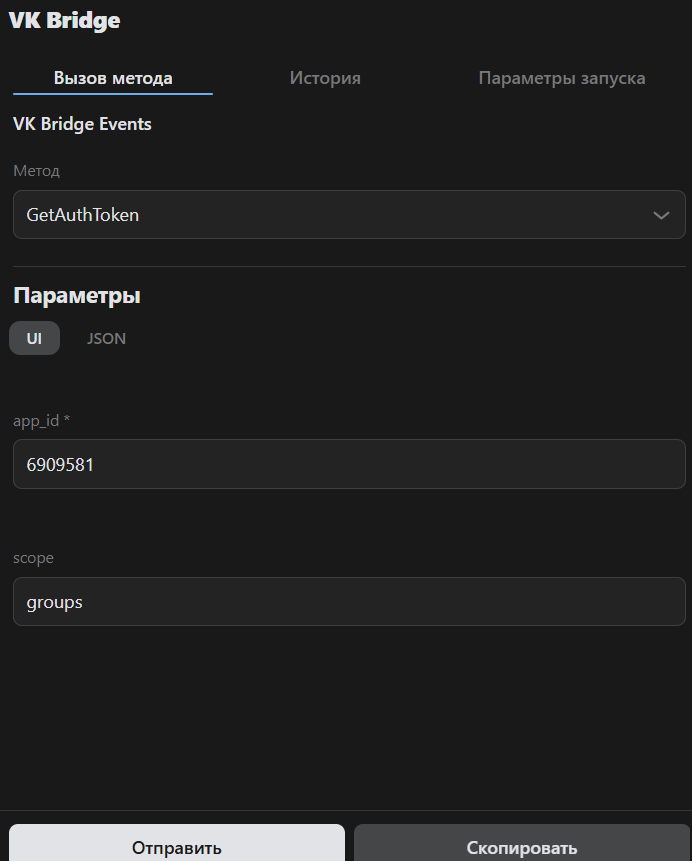

# Storm Events Comments Collector

Программа для переноса комментариев из обсуждений ВК в гугл таблицы.

## Как запустить?

Склонировать репозиторий

Переименовать `.env.example` в `.env` и заполнить поля

Получить доступ к гугл таблицам, следуя [инструкции](https://habr.com/ru/articles/825404/). 
Получившийся файл поместить в папку `google_sheets` и переименовать в `creds.json`

Установить зависимости

```bash
uv sync
```

Запуск

```bash
uv run src/main.py
```

### Как получить токен ВК?

Заходим в приложение [VK Bridge Sandbox](https://vk.com/services?ref=catalog_recent&w=app6909581_70726048).

Выбираем метод `GetAuthToken`.

В параметрах `scope` указываем `groups`.

Нажимаем "Отправить" и копируем токен.



## Стек
- python >= 3.13.1
- httpx >= 0.28.1
- gspread >= 6.2.1
- python-dotenv >= 1.2.2